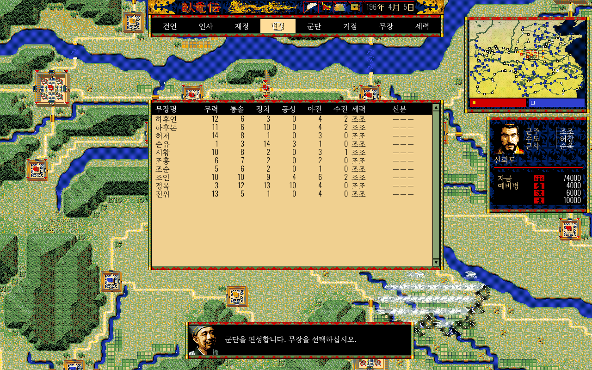
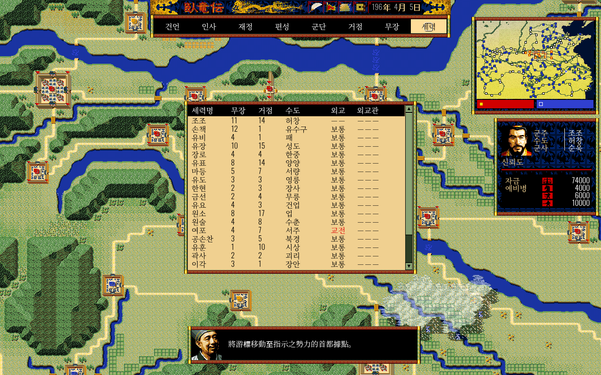

# 와룡전(臥龍傳) Web - 한글화 샘플 포크

삼국지 전략 시뮬레이션 **와룡전: 삼국제패지계** Web 버전의 한글화 **샘플** 포크입니다.
원본 저장소: [tianyi092-jcza/dragon](https://github.com/tianyi092-jcza/dragon)

> **샘플 범위 안내**: 이 포크는 전체 게임이 아니라 **시작 메뉴·전략 화면, 편성·군단/행군·재정·인사 내부 UI, 그리고 인명·지명·세력명 표시**를 한글화한 샘플입니다.
> 시나리오(챕터) 이름, 군사(어드바이저) 등 긴 대사, 전투 화면 전체는 아직 원문(중국어) 그대로 남아 있습니다.

## 플레이

- 라이브 데모(GitHub Pages): <https://sigco3111.github.io/dragon/web/>
- 로컬 실행: 저장소 클론 후 `web/` 디렉터리를 정적 서버로 서빙하면 됩니다 (예: `python3 -m http.server`).

## 한글화 내용 (샘플)

| 구분 | 상태 |
| --- | --- |
| 시작 메뉴 (타이틀/챕터 선택/세력 선택/확인 대화상자) | 한글화 완료 |
| 전략 화면 상단 메뉴바 (건언·인사·재정·편성·군단·거점·무장·세력) | 한글화 완료 |
| 편성 (무장 선택·병종 전환·병력·확정) | 한글화 완료 |
| 군단/행군 (위치 확인·군단 목록·목표 선택·직접 지휘/위임·해산) | 한글화 완료 |
| 재정 (수입/지출·이번 달 말/다음 달·세율/징병수·숫자 입력) | 한글화 완료 |
| 인사 (내정관/외교관 임명·해임·거점/세력/무장 선택) | 한글화 완료 |
| 전략 화면 군주 패널 (군주·수도·군사·신뢰도·자금·예비병) | 한글화 완료 |
| 저장/불러오기·새 게임·공개 게임 플레이어 UI 일부 | 한글화 완료 |
| 인트로 화면 텍스트 | 한글화 완료 |
| 인명·지명·세력(군주)명 (무장 약 480명, 거점 약 200곳) | 한글 표기로 표시 (3차, 아래 참고) |
| 챕터명·군사 대사 등 긴 문장 | **원문 유지 (샘플 범위 외)** |
| 상단 바 날짜 표시 (年/月/日) | 원문 유지 — 툴바 **이미지 에셋에 굳어 있어** 텍스트 교체가 불가 |

## 스크린샷 (실제 배포본 캡처)

| 시작 메뉴 | 전략 화면 (군주 패널) | 전략 화면 (미니맵) |
| --- | --- | --- |
|  |  |  |

## 전략 메뉴 내부 한글화 (2026-10-26 2차)

| 편성 | 재정 | 행군 명령 |
| --- | --- | --- |
|  |  |  |

- 상단 **편성**에서 무장을 고른 뒤 녹색 병종 아이콘을 눌러 병종을 바꾸고 **확정**합니다. 주장을 포함한 여섯 부대의 예비병 배분은 원본 규칙을 따릅니다.
- **군단 > 행군 지시**에서 군단을 고르고 지도에서 목표 거점을 선택한 뒤 **직접 지휘** 또는 **위임**을 고릅니다. **해산**은 수도에서 선택 가능한 원본 조건을 유지합니다. 우클릭하면 이전 화면으로 돌아갑니다.
- **재정**의 다음 달 세율·징병수를 누르면 숫자 입력창이 열립니다. **취소·최대·결정** 버튼과 원본 입력 범위를 유지합니다.
- **인사**에서는 내정관/외교관의 임명·해임 대상과 무장을 선택합니다. 무장명과 지명은 3차에서 한글 표기로 표시됩니다.

검증: PC Chrome의 실제 Pages에서 군단 편성(0개 → 1개), 재정 숫자 입력 및 값 반영, 내정관 임명, 군단 목표 선택과 직접 지휘 명령 제출을 확인했습니다. 대표 화면의 한글 배치도 확인했습니다. 모든 챕터·모든 임명/해임 조합·장시간 행군 결과·모바일은 검증하지 않았습니다. 행군 목표가 바뀌는 기존 현상의 원인 조사는 이번 범위에 포함하지 않았습니다.

병종 아이콘과 상단 날짜처럼 이미지에 포함된 한자는 그대로 남습니다. 시나리오·원본 대사와 전투 화면 전체 번역은 다음 작업입니다. 정적 Pages에서는 원본 공지 API가 없어 '공지를 불러올 수 없음'이 표시되지만 게임 진입은 가능합니다.

## 인명·지명 한글화 (2026-10-26 3차)

| 세력 선택 | 무장 목록 (편성) | 세력 목록 |
| --- | --- | --- |
|  |  |  |

- 조조·유비·손책, 허창·성도·업처럼 익숙한 한국어 독음으로 **무장·거점·세력(군주)명**을 화면에 표시합니다. 한자 독음 사전으로 만들고, 樂進(악진)·郗正(극정) 등 예외 독음은 직접 보정했습니다.
- **표시 계층 방식**입니다. `web/src/core/koreannames.js`(이름 사전)와 `koreannamespatch.js`(캔버스 글자 그리기·DOM 텍스트 치환)가 화면에 그릴 때만 이름을 바꿉니다. `data.json`과 챕터 데이터의 한자 이름, 내부 ID, 상태, 세이브, 게임 규칙은 **그대로**입니다. 그래서 기존 저장 데이터와 호환되고 이름 때문에 기능이 깨질 위험이 없습니다.
- 두 글자 이상의 이름은 문장 안에서도 바꾸고, 한 글자 지명(魯·陳 등)은 그 글자만 단독으로 나올 때만 바꿉니다. 한자 문장 속에 이름만 한글로 섞이는 어색함을 피하려고, 한자가 많이 남는 문장(챕터 제목, 긴 대사)은 원문 그대로 둡니다. 대사 안에서 따로 그려지는 강조 지명(예: 진류)만 한글로 보입니다.

검증: 실제 Pages(<https://sigco3111.github.io/dragon/web/>)에서 새 게임을 시작해 세력 선택표, 무장 목록, 편성 무장 선택과 군단 편성 확정(군단 6개 → 7개), 세력 목록을 확인했고 페이지 오류는 0건이었습니다. **전투 화면의 이름 표시와 장시간 행군은 이번에 확인하지 않았습니다.**

## 기술 메모

- 글꼴: Google Fonts CDN의 **Noto Serif KR**을 UI 텍스트에 적용했습니다. CDN 연결이 불가한 오프라인 환경에서의 폴백 동작은 **아직 검증하지 않았습니다**.
- 내부 ID·상태·게임 로직·데이터 구조는 변경하지 않았습니다 (번역은 표시 문자열만 대상). 인명·지명은 데이터가 아니라 화면 표시 단계에서만 한글로 바꿉니다.
- 수도 함락 수정(TALK30 suspend/resume + 저장 가드) 등 포크에 이미 있던 동작 수정은 그대로 유지했습니다.
- 원본(중국어) README는 **README.zh.md**로 옮겨 보존했습니다. (원문 표기가 중국어이므로 README.en.md가 아닌 README.zh.md 명명)

## 권리 고지

《와룡전: 삼국제패지계》 및 원작 게임 데이터(이미지, 음악, 텍스트, 시나리오 등)의 저작권은 NEO·GETEN 및 송강(松崗)에 있습니다. 리메이크 챕터는 쉬엔워안춘추 문화 포럼(www.xycq.org.cn)의 yanguodong님이 공개한 것이며, 로딩 페이지 음악은 영화 《소림축구》 주제곡 opening(황영화 작)입니다. 오리지널 코드는 MIT 라이선스이며 원작 및 서드파티 자료는 MIT 범위에 포함되지 않습니다. 자세한 내용은 README.zh.md의 원문 고지를 참조하세요.
