# 와룡전(臥龍傳) Web - 한글화 샘플 포크

삼국지 전략 시뮬레이션 **와룡전: 삼국제패지계** Web 버전의 한글화 **샘플** 포크입니다.
원본 저장소: [tianyi092-jcza/dragon](https://github.com/tianyi092-jcza/dragon)

> **샘플 범위 안내**: 이 포크는 전체 게임이 아니라 **시작 메뉴·전략 화면, 편성·군단/행군·재정·인사 내부 UI, 그리고 인명·지명·세력명 표시**를 한글화한 샘플입니다.
> 챕터 이름과 전략·전투 대사는 표시 단계에서 한글로 표시합니다. 전략 대사는 942건 오버레이(나머지 81건은 빈 슬롯·기호), 전투 대사는 424건 오버레이이며, 모든 화면·상황의 실플레이 검증을 뜻하지 않습니다.

## 플레이

- 라이브 데모(GitHub Pages): <https://sigco3111.github.io/dragon/web/>
- 로컬 실행: 저장소 클론 후 `web/` 디렉터리를 정적 서버로 서빙하면 됩니다 (예: `python3 -m http.server`).

## 한글화 내용 (샘플)

| 구분 | 상태 |
| --- | --- |
| 시작 메뉴 (타이틀/챕터 선택/세력 선택/확인 대화상자) | 한글화 완료 |
| 전략 화면 상단 메뉴바 (건언·인사·재정·편성·군단·거점·무장·세력) | 한글화 완료 |
| 편성 (무장 선택·병종 전환·병력·확정) | 한글화 완료 |
| 군단/행군 (위치 확인·군단 목록·목표 선택·직접 지휘/위임·해산) | 한글화 완료 |
| 재정 (수입/지출·이번 달 말/다음 달·세율/징병수·숫자 입력) | 한글화 완료 |
| 인사 (내정관/외교관 임명·해임·거점/세력/무장 선택) | 한글화 완료 |
| 전략 화면 군주 패널 (군주·수도·군사·신뢰도·자금·예비병) | 한글화 완료 |
| 저장/불러오기·새 게임·공개 게임 플레이어 UI 일부 | 한글화 완료 |
| 인트로 화면 텍스트 | 한글화 완료 |
| 인명·지명·세력(군주)명 (무장 약 480명, 거점 약 200곳) | 한글 표기로 표시 (3차, 아래 참고) |
| 전투 화면 UI (명령·부대 역할·병력/사기·작전 제목·효과 라벨) | 한글화 완료 (4차, 아래 참고) |
| 전투 중 무장 대사 (전투 토크 424건) | 한글화 완료 (5차) |
| 챕터명 (20장분) | 표시층 한글화 완료 (5차) |
| 군사(어드바이저) 대사 | 전략 대사 오버레이 적용 (별도 내장 장문 산문은 확인되지 않음) |
| 상단 바 날짜 표시 (年/月/日) | 원문 유지 — 툴바 **이미지 에셋에 굳어 있어** 텍스트 교체가 불가 |

## 스크린샷 (실제 배포본 캡처)

| 시작 메뉴 | 전략 화면 (군주 패널) | 전략 화면 (미니맵) |
| --- | --- | --- |
| 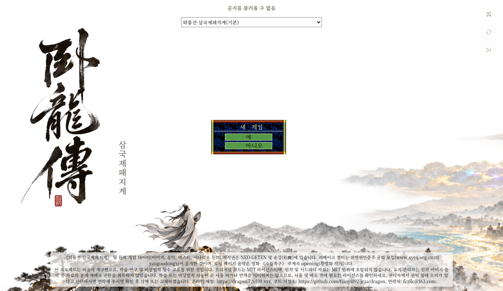 | 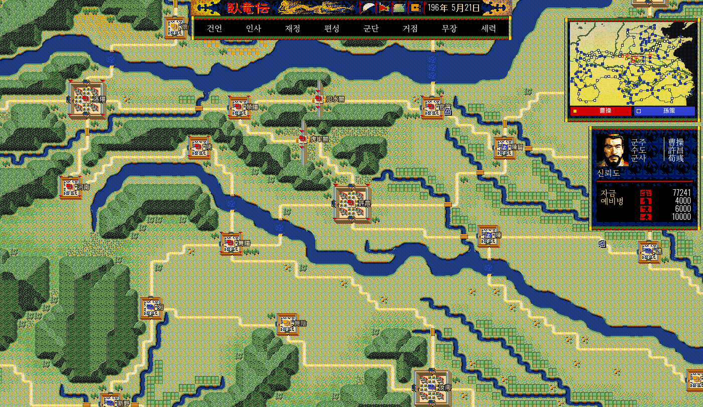 | 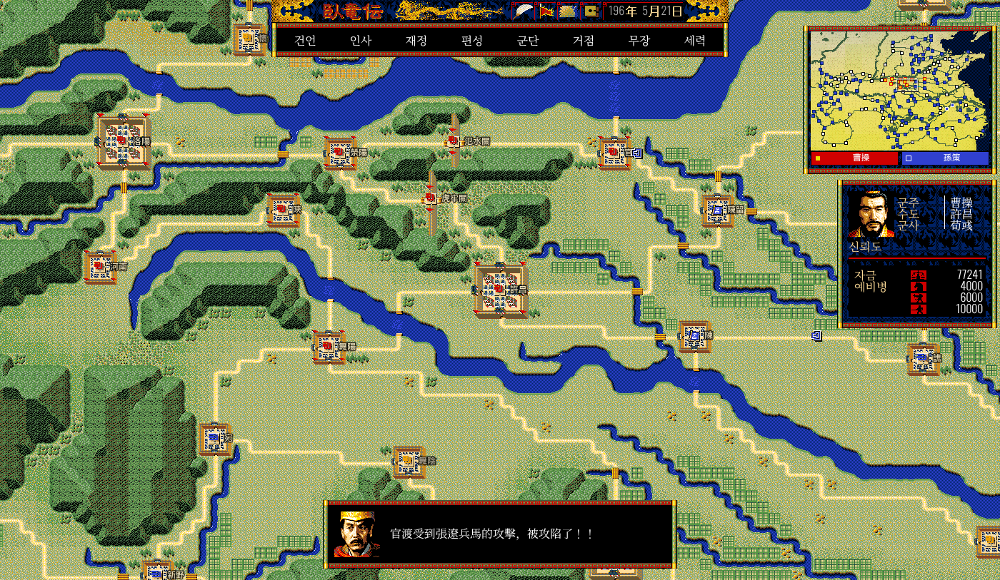 |

## 전략 메뉴 내부 한글화 (2026-10-26 2차)

| 편성 | 재정 | 행군 명령 |
| --- | --- | --- |
| 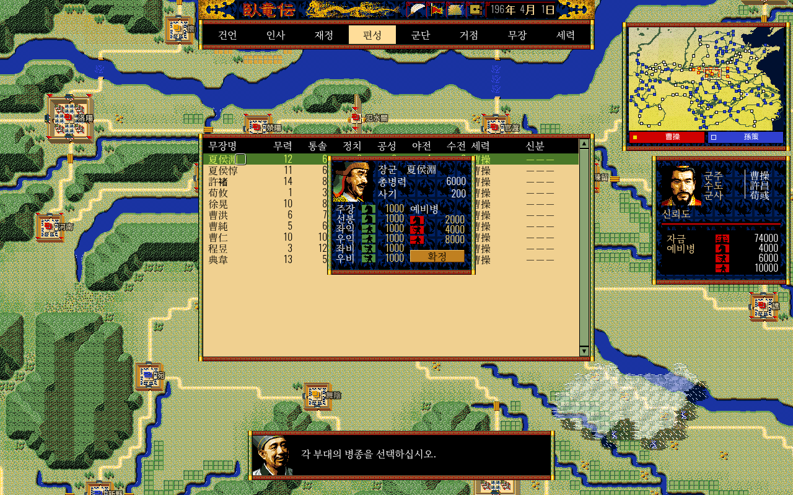 | 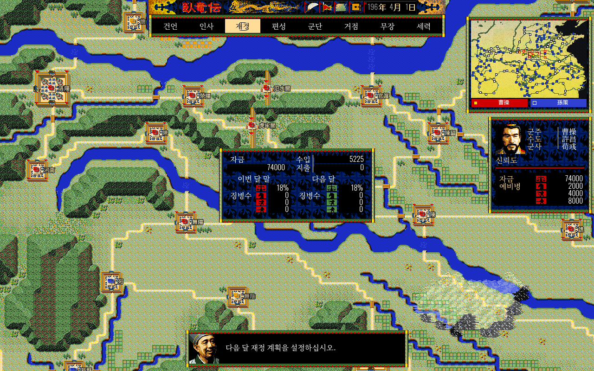 | 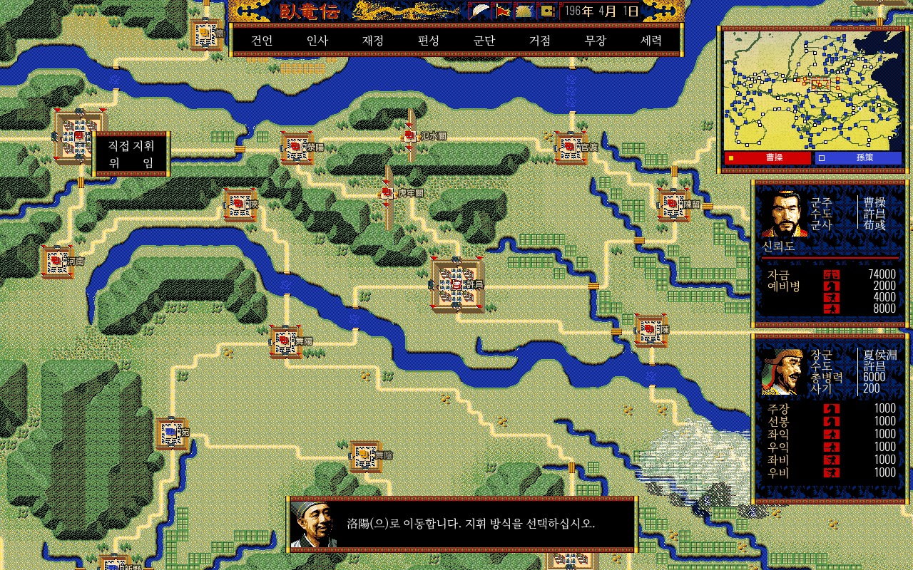 |

- 상단 **편성**에서 무장을 고른 뒤 녹색 병종 아이콘을 눌러 병종을 바꾸고 **확정**합니다. 주장을 포함한 여섯 부대의 예비병 배분은 원본 규칙을 따릅니다.
- **군단 > 행군 지시**에서 군단을 고르고 지도에서 목표 거점을 선택한 뒤 **직접 지휘** 또는 **위임**을 고릅니다. **해산**은 수도에서 선택 가능한 원본 조건을 유지합니다. 우클릭하면 이전 화면으로 돌아갑니다.
- **재정**의 다음 달 세율·징병수를 누르면 숫자 입력창이 열립니다. **취소·최대·결정** 버튼과 원본 입력 범위를 유지합니다.
- **인사**에서는 내정관/외교관의 임명·해임 대상과 무장을 선택합니다. 무장명과 지명은 3차에서 한글 표기로 표시됩니다.

검증: PC Chrome의 실제 Pages에서 군단 편성(0개 → 1개), 재정 숫자 입력 및 값 반영, 내정관 임명, 군단 목표 선택과 직접 지휘 명령 제출을 확인했습니다. 대표 화면의 한글 배치도 확인했습니다. 모든 챕터·모든 임명/해임 조합·장시간 행군 결과·모바일은 검증하지 않았습니다. 행군 목표가 바뀌는 기존 현상의 원인 조사는 이번 범위에 포함하지 않았습니다.

병종 아이콘과 상단 날짜처럼 이미지에 포함된 한자는 그대로 남습니다. 시나리오·원본 대사와 전투 화면 전체 번역은 다음 작업입니다. 정적 Pages에서는 원본 공지 API가 없어 '공지를 불러올 수 없음'이 표시되지만 게임 진입은 가능합니다.

## 인명·지명 한글화 (2026-10-26 3차)

| 세력 선택 | 지도 거점 이름 | 무장 목록 (편성) |
| --- | --- | --- |
| 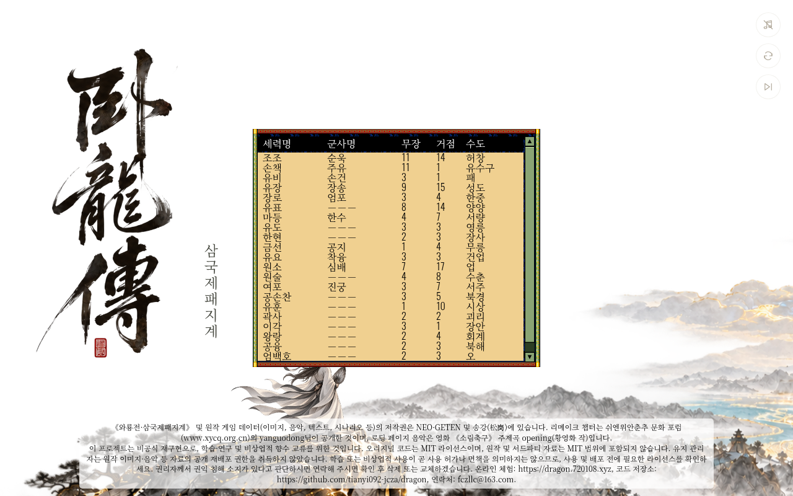 | 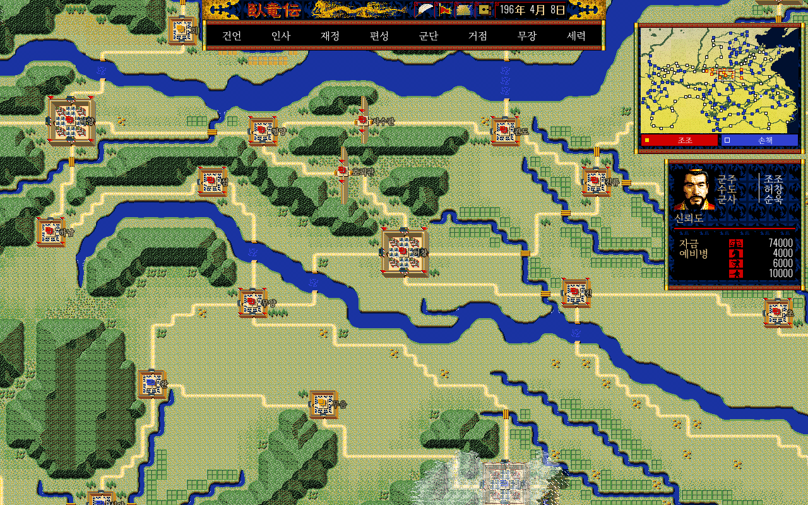 | 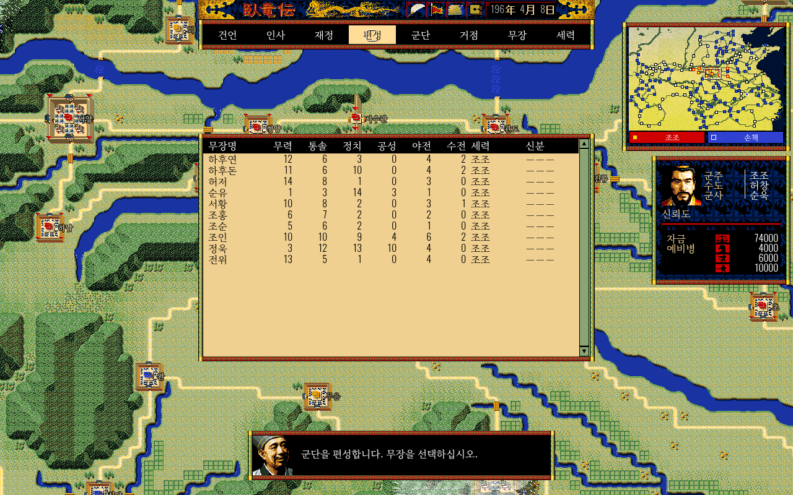 |

| 세력 목록 |
| --- |
| 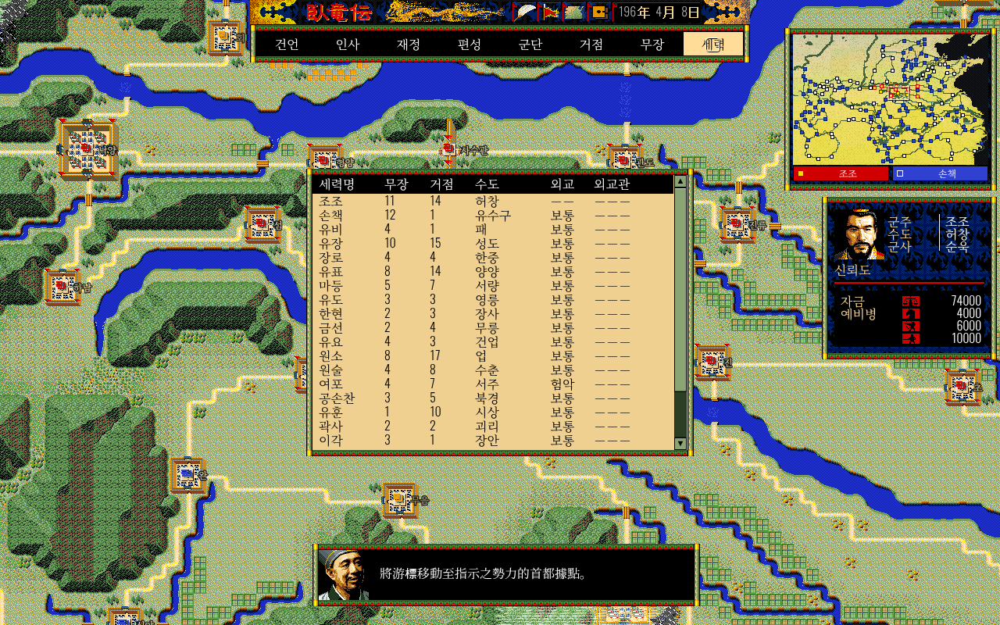 |

- 조조·유비·손책, 허창·성도·업처럼 익숙한 한국어 독음으로 **무장·거점·세력(군주)명**을 화면에 표시합니다. 한자 독음 사전으로 만들고, 樂進(악진)·郗正(극정) 등 예외 독음은 직접 보정했습니다.
- **표시 계층 방식**입니다. `web/src/core/koreannames.js`(이름 사전)와 `koreannamespatch.js`(캔버스 글자 그리기·DOM 텍스트 치환)가 화면에 그릴 때만 이름을 바꿉니다. `data.json`과 챕터 데이터의 한자 이름, 내부 ID, 상태, 세이브, 게임 규칙은 **그대로**입니다. 이름 데이터 파일과 내부 ID는 바꾸지 않았음을 저장소에서 확인했습니다. 다만 화면 출력 함수(캔버스 글자 그리기·글자 폭 측정, DOM 텍스트)를 전역으로 가로채는 방식이라, 확인하지 못한 화면(특히 전투 화면)에서 표시 문제가 생길 수 있습니다.
- 지도 거점 라벨은 원래 한글 글리프가 없는 글꼴을 써서, 한글로 바뀐 이름에 한해 Noto Serif KR을 앞에 붙여 그립니다. 처음 패치 직후에는 이 보정이 없어 지도 거점 이름이 사라졌고, 비교 캡처로 확인해 수정했습니다.
- 두 글자 이상의 이름은 문장 안에서도 바꾸고, 한 글자 지명(魯·陳 등)은 그 글자만 단독으로 나올 때만 바꿉니다. 한자 문장 속에 이름만 한글로 섞이는 어색함을 피하려고, 한자가 많이 남는 문장(챕터 제목, 긴 대사)은 원문 그대로 둡니다. 대사 안에서 따로 그려지는 강조 지명(예: 진류)만 한글로 보입니다.

검증: 실제 Pages(<https://sigco3111.github.io/dragon/web/>)에서 새 게임을 시작해 세력 선택표, 지도 위 거점 이름(한글 글꼴 보정 포함, 패치 전후 화면 비교), 무장 목록, 편성 무장 선택과 군단 편성 확정(군단 6개 → 7개), 세력 목록을 확인했고 페이지 오류는 0건이었습니다. **전투 화면의 이름 표시와 장시간 행군은 이번에 확인하지 않았습니다.**

## 전투 화면 한글화 (2026-10-26 4차)

| 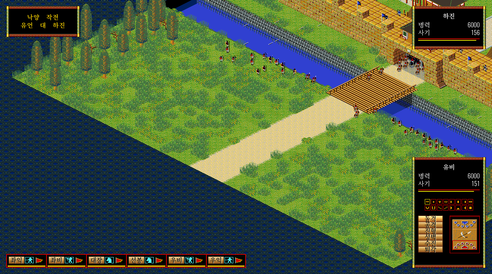 |  |  |
| --- | --- | --- |

- 전투 명령 버튼(돌격·공격·진형·성벽·수진·퇴각)과 명령 선택 시 설명 문구, 부대 역할 표시(좌익·좌비·대장·선봉·우비·우익), 병력·사기, 공격측·수비측, 작전 제목(예: 낙양 작전 / 유언 대 하진), 전투 효과 라벨(측격·배격·포위·협격·돌진·일제사격)을 한글로 표시합니다. 전투 중 저장 불가 안내도 한글로 바꿨습니다.
- 캔버스에 직접 그려지는 효과 라벨은 글꼴 문자열에 Noto Serif KR을 추가해 한글 글리프가 나오도록 보정했습니다.
- 전투 중 무장 대사(전투 토크, 약 420건)는 **이번 범위에서 제외**하고 원문(중국어) 그대로 둡니다. 다음 차수에서 별도로 다룹니다.

검증: 실제 Pages(<https://sigco3111.github.io/dragon/web/>)에서 새 게임(리메이크 1장, 유언 세력)을 시작해 편성 화면으로 군단을 만든 뒤 전투 화면을 열어 확인했습니다. 빠른 UI 검증을 위해 개발자 콘솔로 테스트 공성전을 준비했습니다(편성 화면에서 만든 실제 군단을 공격측으로 쓰고, 수비측 군단을 낙양에 배치한 뒤 실제 전투 개시 경로를 호출). 이 상태에서 부대 카드 선택 → 공격·돌격 버튼 실클릭 시 한글 명령 설명 표시("선택 부대가 적군을 공격합니다." 등), 부대 이동과 성문 앞 교전, 병력(6000→5930)·사기(162→138) 수치 변화를 실시간으로 확인했습니다. 야전(필드 전투)은 엔진이 원본 저장소부터 네이티브 시나리오에서 예외를 던져 시작 자체가 막혀 있어(원본 코드와 동일함을 비교 확인) 이번에도 검증하지 못했습니다. 전투 종료 검증(2026-10-26 추가): 실제 Pages에서 AI가 자연 편성한 실제 군단(관우 군 대 曹操·朱僬 군)으로 콘솔 준비 공성전을 종료까지 진행했습니다. 퇴각·패전으로 끝나는 종료는 결과 쓰기반환(퇴각 군단 사기 200→99 반영)과 전략 화면 복귀가 정상 동작함을 확인했습니다. 반면 수비 군단 전멸로 이기는 종료는 4차 시점에는 전략 시계가 정지하며 승리 결과 표시에 도달하지 못했습니다. 같은 날 20:35 추가 조사에서 원인을 규명해 수정했습니다: 플레이어 전투 종료 경로(dispatchLegionFate)가 운명 메시지 블록 핸들러 없이 호출되어, 플레이어 관련 귀환·포로 메시지(TALK31/32/33/34)에서 원본의 정지가 발동하던 문제였습니다. AI 도로 경로에 이미 있던 일시중지 채널을 플레이어 종료 경로에도 연결해 고쳤고(원본 규칙·상태 기록 불변, 메시지만 기존 큐로 표시), 수정 후 실제 Pages에서 콘솔 등록 군단으로 승리(낙양 공성 수비 전멸 → 낙양 점령·수비 군단 소비·운명/선전포고 메시지 표시·닫은 뒤 시계 재개)와 패배-전멸(공격 군단 운명 처리·시계 정상)을 확인했습니다. 자연 플레이 경로(실제 진행으로 AI 군단과 싸워 이기는 종료)는 장시간 플레이 미검증으로 남습니다. 전투 대사 표시, 장시간 전투, 모바일도 확인하지 않았습니다.

## 전투·전략 대사 한글화와 대사창 개선 (2026-10-26 5차)

| 전투 대사 (자연 출력) | 모바일 전략 화면 |
| --- | --- |
|  |  |

- 전략 대사 942건과 전투 대사 424건에 한글 오버레이(`web/talk_ko.json`, `web/battle_talk_ko.json`)를 적용했습니다. 전략 대사 카탈로그 1023건 중 오버레이 밖 81건은 빈 슬롯 79건과 말줄임 기호 전용 2건뿐이라 사실상 전량이며, 전투 대사는 424건 전량입니다(두 오버레이 안에 중국어 잔여 레코드 0건). 원본 대사 데이터와 내부 ID는 그대로 두고 표시 단계에서만 한글로 바꿉니다.
- 한자 이름이 한글로 바뀐 뒤 어긋나던 조사(을/를, 이/가, 은/는, 과/와, 로/으로, 아/야)를 받침에 맞게 표시 단계에서 교정합니다(예: "나 관우를 얕본 것이군!").
- 원본 대사의 조각 경계를 그대로 따라간 번역으로 생긴 붙음("전투가가장" 류)을 정리해, 이어 그리는 경로에서도 단어 사이가 자연스럽게 띄워집니다.
- 플레이어 측 대사창이 부대 카드 줄과 겹치던 것을 카드 줄 위로 옮겼고, 대사창이 카드와 화면 가장자리에 닿지 않게 했습니다.
- 한글 대사는 공백 단위로만 줄바꿈해 끝 음절만 다음 줄로 넘어가는 현상을 없앴습니다. 공백 없는 원문(중국어) 대사는 넘침 방지용 분리만 허용합니다.
- 시나리오 장 제목을 표시 단계에서 한글로 바꿉니다(예: 제1장．「황건적의 난」의 권, [원판]제1장．「여포의 최후」의 권). 내부 시나리오 이름은 원본 그대로라 세이브와 규칙에 영향이 없습니다.
- 모바일에서 뷰포트 메타가 없어 페이지가 980px 폭으로 그려진 뒤 축소 표시되던 것을 width=640 레이아웃으로 고쳤습니다. 표시 전용 변경으로 데스크톱에는 영향이 없습니다.

검증: 실제 Pages(<https://sigco3111.github.io/dragon/web/>)에서 자연 전투 중 한글 대사 출력(조사 교정 포함), 대사창·카드 줄 비겹침, 장 선택 화면 한글 제목을 확인했습니다. 모바일은 에뮬레이션(390×844)에서 인트로·장 선택·세력 선택·전략 맵이 화면 폭 안에 표시됨을 확인했고, 실기기 터치 조작감과 가독성은 검증하지 않았습니다. 전체 대사의 수동 원문 대조와 장시간 플레이는 이번에 확인하지 않았습니다.

## 대사창 리플로·월 재정 수정·전투 대사 실전 검증 (2026-10-27 6차)

- **월 재정 처리 중단 수정**: 편성으로 새로 만든 군단 레코드에 월간 재정 처리가 읽는 필드가 없어, 그 군단이 있는 채로 월이 바뀌면 "전략 처리 실패로 시간이 정지"되던 문제를 고쳤습니다. 한글화와 무관한 상류 게임 로직 문제로, 실제 플레이 중 월 경계에서 재현을 확인한 뒤 편성 시 해당 필드에 기본값 0을 부여했습니다(게임 규칙·세이브 계약은 그대로). 수정 후 편성 군단이 있는 상태로 세 번의 월 전환을 전략 시계 정지 없이 통과함을 실제 Pages에서 확인했습니다.
- **괄호형 조사 교정**: 행군 불가 안내·출발 메시지·외교 흐름에 "은(는)"·"이(가)"·"과(와)" 괄호형으로 남아 있던 조사를 표시층 교정으로 받침에 맞게 고릅니다(예: "「엄안」 군단이 「답중」으로 출발합니다."). 외교 흐름 잔여 11건을 포함합니다.
- **대사창 자동 리플로**: 원본은 데이터에 미리 그어진 줄바꿈을 그대로 쓰기 때문에 한글로 길어진 대사가 상자 폭을 넘겼습니다. 표시 단계에서 실제 상자 폭과 실제 폰트(16px Noto Serif KR 측정)를 기준으로 폭을 넘는 행만 다시 줄바꿈합니다. 공백 경계를 우선하고, 문장부호만 다음 줄로 남는 고립을 막으며, 네 줄을 넘는 긴 대사는 상자를 위로 늘려 하단 위치를 유지합니다. 데이터 자체가 넘치던 군주 승인 대사는 두 행을 세 행으로 안전하게 나눴습니다.
- **전투 대사 실전 검증 (정상 입력 + 가시성 강제 표시 검증)**: 편성 → 군단 → 행군 지시 → 공성(직접 지휘)의 정상 게임플레이 입력으로 공성전 세 차례를 진행했습니다. 클라우드 브라우저 탭은 항상 비활성 상태라 원본 설계상 전투 대사 표시가 열리지 않아, 테스트 세션에서 가시성 조건을 강제로 맞춘(표시층 전용, 게임 규칙 변경 없음) 표시 검증입니다. 개전교섭의 항복 권고와 거절, 성벽 수비, 돌격·공격, 퇴각, 패전 종료 대사("마등, 이 빚은 네 목으로 갚게 해주마!") 등 대화 텍스트 로그를 확보했고, 공격·퇴각 대사 상자의 화면 캡처 두 건으로 배치를 확인했습니다. **종료 대사의 화면 픽셀, 가시성을 바꾸지 않은 실기기 환경, 장시간 전투는 검증하지 않았습니다.**
- **자연 개전 미발생은 결함이 아님**: 관찰 기간 다른 세력이 플레이어에게 선전포고하는 일은 없었습니다. 원본 규칙상 선전은 공격측→목표 세력 관계가 호전성 기반 임계 이하여야 하는데, 관찰 대상인 마등→유언 관계(183)가 임계(182)를 한 포인트 상회해 성립하지 않았습니다. 외교 건언(적대)은 비대칭 관계 행렬에서 건언한 측(유언→마등)의 관계만 낮추므로 상대의 선전 판정에는 직접 영향이 없는 원본 설계입니다.
- 알려진 잔여: 전략 대사 오버레이 앞부분 일부가 하십시오체·"휴전" 표기이고 화면 안내(HUD)는 하세요체·"정전" 표기로 어조·용어가 다릅니다. 어조가 다른 레코드 일부는 게임이 호출하지 않는 미사용 데이터라 화면 표시에는 영향이 없습니다. 통일은 다음 차수 판단 사항으로 남깁니다.

검증: 실제 Pages(<https://sigco3111.github.io/dragon/web/>)에서 알현 대사(외교비 알현 256px 폭 상자 포함)와 전투 대사 상자가 상자 안에 표시됨을 캡처로 확인했고, 긴 대사가 네 줄을 넘을 때 상자가 위로 늘어나는 동작을 확인했습니다. 모든 대사·모든 뷰포트 조합은 확인하지 않았습니다.

## 모바일 터치 지원과 실전 회귀 검증 (2026-10-27 8차)

- **모바일 보조 오버레이**: 터치 기기(pointer: coarse)에서만 화면 좌측에 '뒤로' 버튼을 자동으로 붙입니다. 우클릭과 같은 계층 뒤로가기 동작을 하며, `?mobileui=1`로 강제 표시할 수 있습니다. PC 환경에는 표시되지 않습니다.
- **포인터 이벤트 이주**: 지도·전투 입력을 mouse 이벤트에서 pointer 이벤트 경로로 이주해 터치에서도 같은 코드 경로로 처리합니다(규칙 변경 없음, `touch-action: none`으로 제스처 간섭 방지).
- **터치 목표 실측 보정**: 이 게임은 640px 고정 레이아웃을 기기 폭에 맞춰 축소 표시(390px 기기에서 약 0.61배)하므로, CSS 픽셀이 아니라 실제 표시 크기 기준으로 맞췄습니다. 뒤로 버튼 84×80 CSS px(실효 약 51×49px), 전투 명령 버튼 92×32 CSS px(실효 약 56×20px)·6개 전부 화면 안에 들어옴을 확인했습니다. 전투 대화 글씨는 coarse 포인터에서 20px로 키우고, 하단 부대 카드 줄과 역할 라벨도 52px·48×26으로 키웁니다(초기 배포는 게임 JS의 인라인 높이와 CSS 규칙 순서에 덮여 카드가 미적용이었고, !important 보정으로 수정했습니다).
- **구조적 한계(미완)**: 시작 메뉴·전략 지도·전투 장면의 문자는 캔버스에 비트맵으로 그려지므로 CSS로 키울 수 없고, 640px 고정 설계상 390px 기기에서 약 0.61배로 작게 보이는 것은 이번 차수에서 해결하지 못했습니다. 뷰포트 메타는 확대를 막지 않지만, 핀치 줌의 실제 동작은 실기기에서 검증하지 못해 해결책으로 단정하지 않습니다. 전투 지도 오른쪽 일부가 390px 화면 밖에 놓이며, 전장은 드래그로 이동해 볼 수 있습니다.
- **실전 회귀 검증**: [원판]제1장(196년) 조조 세력으로 편성→행군→공성→수비의 실제 플레이를 반복했습니다. 여포군의 진류 공성 방어(1~3차 웨이브)와 원소군의 허창 공성 방어에서 방어 승리 후 전투 화면이 닫히고 전략 시계가 실제로 다시 진행함을 확인했습니다(197-2-4 → 197-3-7 연속 진행 관측). 관찰 기간 발생한 전투는 모두 AI가 자연 발생시킨 것입니다.
- **미검증 한계**: 도시 밖 야전(필드 전투)은 관찰 기간 자연 발생하지 않아 별도 검증하지 못했습니다. 실제 터치 하드웨어가 아닌 합성 포인터 환경의 검증이며, 승리 직후 정상 UI 저장 메뉴 도달은 연속 전투로 창이 짧아 이번 차수에 닫지 못했습니다(빈 성 점령 후 UI 저장·재접속 복원은 7차에서 확인 완료).

검증: 실제 Pages(<https://sigco3111.github.io/dragon/web/>) 배포본을 390×844 모바일 에뮬레이션과 데스크톱에서 불러 뒤로 버튼 자동 부착·도시 카드 닫힘·지도 드래그 팬·새 게임 시작을 확인했고, 전투 화면은 390×844 모바일 에뮬레이션의 배포본에서 스타일 주입 없이 자연 전투(원소군 허창 공성)로 진입해 확인했습니다: 명령 버튼 6개 92×30 CSS px·하단 바와 부대 카드 52px·역할 라벨 48×26이 자동 적용됨을 getBoundingClientRect로 실측했고, 겹침 없이 화면 안에 들어옴을 실제 렌더로 확인했습니다(카드 미적용 결함 수정 후 재검증).

## 모바일 구조 개선·도시 도착 슬롯 22/23 수정 (2026-10-27 9차)

- **모바일 뷰포트 방향 대응**: 세로는 설계 폭 640을 유지하고, 가로는 논리 높이가 720이 되도록 폭을 계산해 전략 UI(상단바·지도·우측 패널)가 세로로 잘리지 않게 합니다. 핀치 줌을 허용합니다(user-scalable, 최대 3배). 표시 전용 변경으로 규칙에는 영향이 없습니다.
- **핀치 줌과 드래그 상태 정리**: 캔버스 touch-action을 pinch-zoom으로 바꿔 두 손가락 확대를 브라우저에 양보하고, 핀치 시작으로 pointercancel이 오면 진행 중이던 지도 드래그 상태를 해제합니다(팬 상태로 멈추는 것 방지).
- **전략 메뉴 DOM 대체 바**: 캔버스 비트맵 메뉴는 640px 설계가 390px 기기에서 약 0.61배로 축소돼 실효 약 10px로 읽기 어렵습니다. coarse 포인터에서 "메뉴" 버튼으로 여닫는 하단 바에 건언~세력 8개를 84×72 CSS px·24px 실버튼으로 둡니다(실효 약 15px). 동작은 게임의 기존 gamebar.click 경로(부채 아이콘 → 메뉴 띠 셀)를 그대로 호출하고, 다른 항목 선택 중 전환 차단 같은 원본 단일 선택 의미는 유지합니다. 대화창 본문 등 나머지 캔버스 텍스트는 여전히 작아 핀치 줌으로 읽는 방식입니다.
- **전투 정보 창 접기(정보 버튼)**: 전투 시 우측 정보 창(.battle-enemy-window/.battle-operation-header)을 접어 전장 가림을 사용자가 해소할 수 있습니다. 명령 창과 대화창은 유지합니다.
- **도시 도착 43D3 슬롯 22/23 시계 동결 수정**: 8차까지의 수정(네이티브 22슬롯 테이블 경유)은 별칭 슬롯 0..21만 커버했고, 도시 44..47 도착(별칭 주소 0x580..0x5FF = 세력 슬롯 22/23)에서 "Invalid native faction slot"으로 전략 시계가 멈추는 것을 리메이크 1장 자연 진행(184-8-1, 장각 세력 변희 군단)에서 재현 확인했습니다. 원본 상태 세그먼트의 세력 영역은 24슬롯×64B이고(RE 노트 실핀), 원본 4챕터 덤프에서 슬롯 22/23은 전부 0이며 알려진 기록자(월 로테이션은 0x580에서 순환)는 22번을 넘지 않습니다. 포트는 이 구간 바이트를 보유하지 않고 구조상 0을 유지하므로(3091 별칭이 이미 같은 모델), 같은 범위를 0으로 읽도록 미러링했습니다. **이는 명시적 모델 가정 하의 호환 수정입니다**: 리메이크 챕터의 실제 DOS 바이트는 원본 DAT가 없어 확인하지 못했고, 0이 아니었다면 원본 초기 동작과 갈라질 가능성이 남습니다.
- 검증: 슬롯 22/23 회귀는 도시 44..47 도착 케이스를 추가한 단위 테스트에서 수정 전 실패(실운영과 같은 TypeError·시계 정지 채널) → 수정 후 통과를 확인했고, 도착 31/31·행군 34/34 스위트가 녹색입니다. 모바일은 실제 Pages의 라이브 화면에 미배포 변경을 주입해 확인했습니다: 세로 390×844·가로 844×390 뷰포트 계산(논리 높이 720), 메뉴 바 8항목 한 줄 표시·가로 스크롤·끝 항목(세력) 실클릭으로 세력 일람 열림, 정보 토글의 display 전환(계산 스타일)까지 확인했습니다.
- 미검증 한계: 실기기 핀치 줌, 전투 화면에서의 정보 토글 실픽셀(실전투 필요), 슬롯 22/23의 리메이크 챕터 원본 바이트, 수정 후 자연 재발(도시 44..47 도착) 관찰은 배포 후 과제로 남습니다.

## 세력 슬롯 폴백 수정·공성전 자연 관찰 (2026-10-27 10차)

- **증원 4117 소유주19 크래시 수정**: AI 도시 군사 처리(증원 requestReinforcement)가 네이티브 세력 슬롯 19를 조회할 때, 선언 뷰(sc.factions, idx 0..15)에 없어 "Uncovered faction 19" RangeError로 전략 시계가 멈추는 것을 리메이크 1장 자연 진행(장각 세력 여남 계열 4도시·자금 정상의 활성 슬롯)에서 재현 확인했습니다. 원본은 22슬롯 네이티브 테이블이 원천이고 선언 뷰는 부분 집합입니다. 도시·편성 양쪽 factionAt에 3FBF 리더의 기존 named-or-native 폴백 패턴을 그대로 적용해 슬롯 0..21을 네이티브에서 읽게 하고, 슬롯 22/23은 9차 43D3 규칙대로 fail-closed를 유지했습니다.
- 검증: 동일 입력 단위 테스트(tools/verify_native_city.mjs)에서 수정 전 워크트리는 실운영과 같은 "Uncovered faction 19 at 4117"로 실패(RED), 수정 후 30/30 통과(GREEN — 전략거점 기록·쿨다운 설정·군단 편성·예비병 소모 지표 확인, 선언 뷰 미확장). 배포 후 자연 진행 184-1-13~184-2-9 구간 동일 분기 재발 없음(시간경과 관찰이며, 직접 분기 증거는 위 단위 테스트).
- **공성전(자연 발생) 추가 관찰**: 선전포고 후 적 세력(장각군 주창·장보) 군단이 자연 행군으로 내 거점(진류)에 도달해 공성전(battle.kind = siege)이 연속 발생했습니다. 진입·유닛 명령(선봉 공격·대장 돌격, 유닛 전진과 적 사기 160→154 관찰)·첫 전투 종료를 플레이어 측 방어로 확인했고, 전투는 모두 AI가 자연 발생시킨 것입니다. **야전(필드 전투) 자연 발생은 이번 관찰에서 확인하지 못해 미검증으로 남습니다** — 위 관찰은 도시 공성전이며 필드 야전의 대체 증거가 아닙니다.
- **조사 교정 실화면**: "진류로 이동합니다."(받침 있는 지명+로) 교정이 실제 프롬프트 픽셀에서 판독 확인됐습니다.

## 모바일 목록·행군 외교 수정·대사 재검토 (2026-10-27 11차, 중간 기록)

- 모바일 목록: coarse 포인터에서 무장·거점·세력 등 목록을 큰 DOM 표로 표시합니다. 배포본 390×844에서 무장 선택 → 작은 초상 대사창 → 뒤로 → 큰 목록 복귀를 확인했습니다. 초상 대사창은 전체 정보 상세 카드가 아닙니다. 390×500 세력 목록은 스크롤 끝 마지막 행과 닫기 버튼을 확인했으나, 스크롤 위치 설정 기반이며 실제 터치 스와이프·실기기 핀치 줌은 미검증입니다. 하단 8개 메뉴는 가로 스크롤 방식으로 한 화면에 모두 보이지 않습니다.
- 42AB 행군 외교 조회 수정: 자연 진행 중 소유주20 군단이 선언 외교 뷰(0..15) 밖을 읽어 전략 처리가 멈추는 오류를 확인했습니다. 원본 24×24 네이티브 외교 행렬을 읽도록 최소 수정했습니다(b3c8ff0). 동일 조건 단위 테스트는 수정 전 오류를 재현하고 수정 후 적대10 전진·평화255 회항을 확인했습니다(8bafbd8). 행군35/35·도착32/32·도시30/30 통과. 별도 road_callers 6건 실패는 전후 동일하며 전체 회귀 통과를 뜻하지 않습니다.
- 자연 분기 증거: 새 게임 무주입 진행에서 43D3 슬롯22/23 별칭 분기 카운터가 실제 증가했습니다(184-11 말 3회, 185-4-9 1665회). 오류 배너 없는 두 화면과 시계 진행을 함께 확인했습니다. 이전 세션의 4117·일일 결산 카운터는 새 게임과 합산하지 않습니다. 새 게임의 4117·일일 결산 폴백과 42AB 소유주20 직접 실행은 아직 미확인입니다. 날짜를 지난 것만으로 해당 분기 실행을 주장하지 않습니다.
- 전투 대사424건 원문 쌍 재검토: 오탈자5건(665·667·671·755·775)을 수정했고, 성벽·성문·진형 용어를 재확인했습니다. 기존 이름 표시 계층이 조사 교정을 수행하므로 중복 교정기를 추가하지 않았습니다.
- 한글 오버레이 로딩: 선택적 JSON이 실패하면 한 번만 재시도하고 원문으로 폴백합니다. 전략 대사는 일시 실패로 생긴 원문 폴백을 영구 캐시하지 않아 다음 호출에서 회복할 수 있습니다. 재시도 한도·다음 호출 회복·실제559 대사 폴백/회복 테스트3/3 통과. 배포본 세 모듈 반영 확인. 과거559 중국어 표시의 원인을 확정한 것은 아닙니다.
- 계속 검증 중: 정상 도로 접촉으로 발생하는 플레이어 야전의 진입·명령·종료, 긴 거점 목록과 실제 터치 조작, 최신 로딩 수정의 새 세션 표시. 공성전과 강제 개시 검증은 자연 야전 증거로 대체하지 않습니다.

## 전략 정지 경고의 모바일 표시 보완 (2026-10-27 12차, 중간 기록)
- 장각 새 게임의 정상 행군 후 184-3-13에 전략 처리가 정지한 별도 문제를 확인했습니다. 이벤트 슬롯29의 협력 요청은 `{type:2,arg0:4,arg1:13,arg2:24}`였고, 네이티브 세력 조회가24를 거부하여 `Invalid native faction slot` 오류와 시계 정지 상태가 유지됐습니다. 이 원본 규칙 경계는 미해결입니다. 이벤트를 건너뛰거나 외교 데이터를 임의로 고치지 않았습니다. 기존 저장은 유지되며 실패 상태의 저장 차단도 유지합니다.
- 모바일에서 정지 경고가 하단 메뉴 뒤에 가려지는 표시 문제를 수정했습니다(0d6718f). 경고를 메뉴 위에 배치하고 글자 크기와 접근성 알림을 보완했습니다. 규칙·시계·저장 동작은 변경하지 않았습니다.
- 배포된 HUD 모듈의 내용 일치와 390×844 표시 전용 검증 화면에서 경고·메뉴의 분리와 한글 판독을 확인했습니다. 이 화면은 실패 상태를 넣은 표시용 검증이며 자연 게임의 재현 증거가 아닙니다. 원래 정지한 게임은 증거 보존을 위해 재시작하지 않았고, 그 게임에는 재시작 전의 표시 모듈이 남아 있습니다.
- 자연 야전의 진입·명령·종료는 아직 미검증입니다. 앞서 진행한 유대 새 게임의 43D3 분기 검증과 이번 장각 정지는 서로 다른 실행입니다. 원본 메모리 배치 해석이 서로 맞지 않는 자료는 결론으로 싣지 않습니다.

## 야간 후속 검증: 해상 도로 야전과 모바일 목록 (2026-10-27)
- 이 항목은 위 11·12차의 '자연 야전 미검증'과 모바일 긴 목록의 미확인 범위를 갱신합니다. 공성전, 합성 테스트, 정상 플레이를 구분합니다.
- 자연 해상 도로 야전: 배포본 새 게임 [원판]제1장 손책으로 정상 군주 출진·행군 명령을 내리고, 유수구로 접근하던 유요군 태사자와 도로에서 접촉했습니다. `battle.kind=field`, 해상 모드2를 확인했습니다. 개전 절차가 끝난 뒤 부대 선택 → 수진(명령 아이콘4) → 퇴각 → 패전 종료 → 전략 지도 복귀와 다음 날 진행을 확인했습니다(한 실행에서196-4-27→4-28). 시나리오 상태·관계를 주입하거나 기존 저장을 덮어쓰지 않았습니다. 육상 야전·전투 승리·모든 종료 분기의 검증은 아닙니다.
- 모바일 긴 목록: 배포본390×844 터치 에뮬레이션에서 리메이크1장 장각의36도시를 터치 스와이프·휠로 끝까지 이동해 마지막 초를 선택하고, 도시 카드의 하단 수치까지 확인했습니다. [원판]제3장 조조의22무장은 휠로 마지막 만총까지 이동해 한글 초상 대사창을 열고 뒤로 돌아오면 목록의 하단 위치가 유지됩니다. 이 초상 대사창은 전체 능력 상세 카드가 아닙니다. 실제 터치 기기·핀치 줌은 미검증입니다.
- 표시 전용 보완: 늦게 활성화되는 터치 포인터에도 보조 메뉴를 붙이고(0337f84), 전역 휠 가로채기가 DOM 목록 스크롤을 막지 않게 했습니다(c9aec5b). 도시 카드가 열리면 하단 메뉴를 접습니다(b1b2d16). 전투에서는 커진52px 부대 바에 맞춰 대사창을 위로 올리고 한글 두 줄 공간을 확보했습니다(f290154). 각 수정은 배포 후 실제 화면을 다시 확인했습니다. 작은 캔버스 글씨와 우측 명령 영역의 답답함까지 모두 해결한 것은 아닙니다.
- 회귀 증거: `node tools/verify_mobile_ui_regressions.mjs`의 늦은 포인터·DOM 휠 경로·정지 경고3그룹이 통과합니다(8fae60c, 합성 단위 테스트). 기존 전투 명령 패널·대사 명령 클릭·대사 경로 테스트도 통과했습니다. 기존 `verify_battle_panel_layout.mjs`는 외부 폰트 차단 및 예전 위치·줄바꿈 기대값 때문에 현재 통과하지 않습니다. 별도 대사 프레젠테이션 테스트는 가짜 캔버스의 style 누락으로 실패하며, 임시 로컬 fixture 보완 후의 통과를 배포 테스트 통과로 계산하지 않습니다.
- 남은 경계: 협력 요청의 세력24 오류는 그대로 미해결이며 이벤트 건너뛰기·규칙 우회는 하지 않았습니다. 유비 육상 야전 탐색 중 `Uncovered overlapping native player decision` 오류가 한 번 관찰됐지만 두 새 실행에서 재현되지 않아 원인·지속 여부를 확정하지 못했습니다. 해상 성공을 전체 안정성으로 확대하지 않습니다. 공개 공지/카탈로그 registry는404이지만 내장 챕터 새 게임은 동작합니다. 원본 KI.EXE가 필요한 검증은 원본 파일 부재로 미완입니다.
- 배포 확인: https://github.com/sigco3111/dragon/commit/f2901549c1125236b277533dc9470d30b8428def / https://github.com/sigco3111/dragon/actions/runs/40510386701 (Success). 테스트 추가: https://github.com/sigco3111/dragon/commit/8fae60cf47fdc1bca1289a1ecf91bc1911d01bea .

## 기술 메모

- 글꼴: Google Fonts CDN의 **Noto Serif KR**을 UI 텍스트에 적용했습니다. CDN 연결이 불가한 오프라인 환경에서의 폴백 동작은 **아직 검증하지 않았습니다**.
- 내부 ID·상태·게임 로직·데이터 구조는 변경하지 않았습니다 (번역은 표시 문자열만 대상). 인명·지명은 데이터가 아니라 화면 표시 단계에서만 한글로 바꿉니다.
- 수도 함락 수정(TALK30 suspend/resume + 저장 가드) 등 포크에 이미 있던 동작 수정은 그대로 유지했습니다.
- 원본(중국어) README는 **README.zh.md**로 옮겨 보존했습니다. (원문 표기가 중국어이므로 README.en.md가 아닌 README.zh.md 명명)

## 권리 고지

《와룡전: 삼국제패지계》 및 원작 게임 데이터(이미지, 음악, 텍스트, 시나리오 등)의 저작권은 NEO·GETEN 및 송강(松崗)에 있습니다. 리메이크 챕터는 쉬엔워안춘추 문화 포럼(www.xycq.org.cn)의 yanguodong님이 공개한 것이며, 로딩 페이지 음악은 영화 《소림축구》 주제곡 opening(황영화 작)입니다. 오리지널 코드는 MIT 라이선스이며 원작 및 서드파티 자료는 MIT 범위에 포함되지 않습니다. 자세한 내용은 README.zh.md의 원문 고지를 참조하세요.
